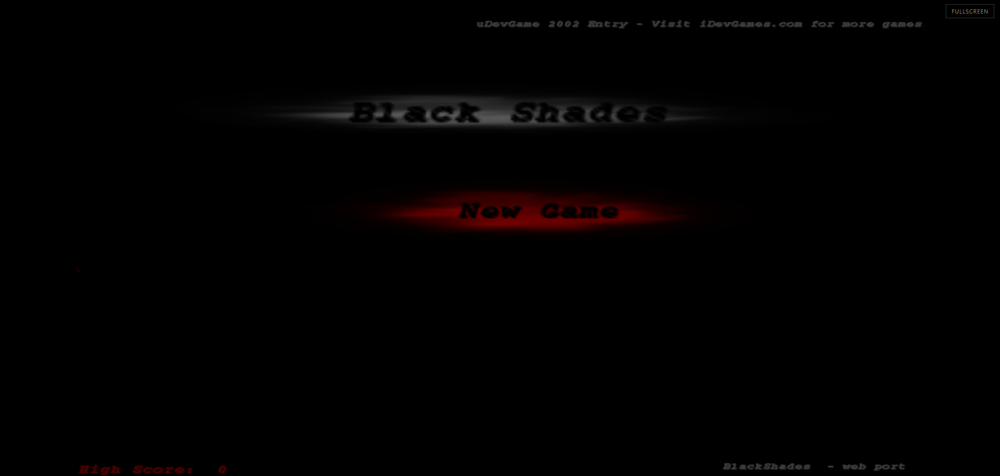
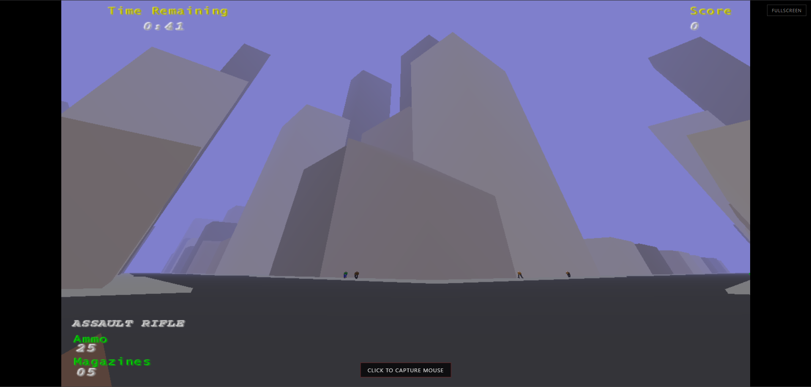
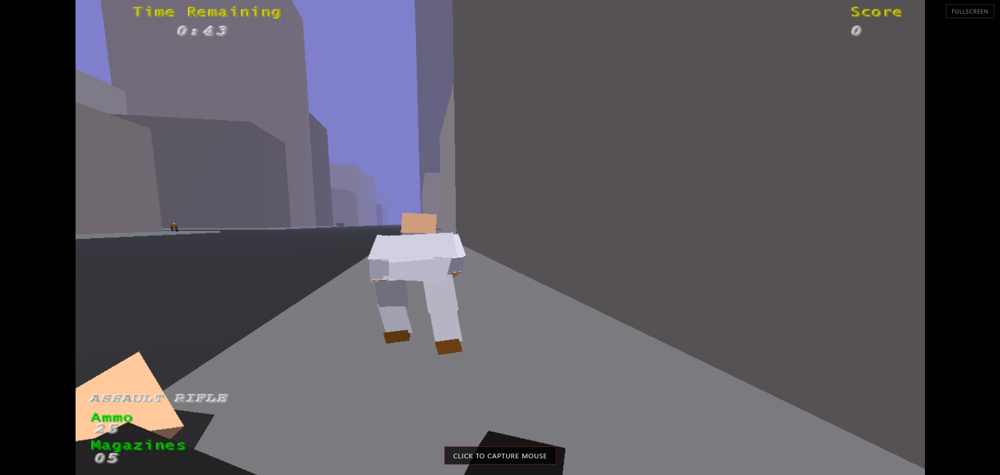

<div align="center">



# blackshades-web

### *Black Shades, the psychic-bodyguard shooter from the creator of Lugaru, running natively in your browser.*

**WebAssembly · WebGL · Zero install**

[](https://zaedian.github.io/blackshades-web/)

    

[Play](#play) · [Screenshots](#screenshots) · [Run locally](#run-locally) · [Controls](#controls) · [How it works](#how-it-works) · [Roadmap](#roadmap) · [Credits](#credits)

</div>

## About the game

> **Black Shades** is a free, open-source first-person shooter with a stealth twist, originally developed by **David Rosen** of **Wolfire Games**.

You play as a **psychic bodyguard** assigned to keep an oblivious, white-suited **VIP** alive. Zombies, snipers and assorted would-be assassins are closing in from every direction. Survive for the set amount of time and the next level begins, in a **freshly generated city**, with a **new weapon** in your hands and tougher enemies waiting.

Black Shades is built around a few ideas that still feel fresh:

- **Protect, don't just kill.** Stop assassins by shooting them, knocking them unconscious, disarming them, tackling the VIP out of the line of fire, or any combination of the above.
- **No crosshair.** Aiming is done with the weapon's **ironsight**, which keeps the screen clean and the shots deliberate.
- **Psychic Aim (slow-motion).** Bend time to line up the perfect shot.
- **Soul Release.** Leave your body and fly over the city to spot threats before they reach the VIP.
- **Procedural city and ragdoll animation.** Every level is different, and every fall is physical.
- **A weapon for every situation.** Handgun, magnum, shotgun, assault rifle, sniper rifle (crouch to scope), grenades and a knife.

**blackshades-web** brings the open-source Black Shades to modern browsers using WebAssembly and WebGL. The goal is a smooth, near-native experience you can play from a link, with no download, installer or plugin.

<a id="play"></a>

## Play

[](https://zaedian.github.io/blackshades-web/)

1. Open the link and wait for the game data to download (~10 MB on the first visit).
2. Click inside the game to capture the mouse.
3. Protect the VIP until the timer runs out to advance to the next level.
4. Press <kbd>Esc</kbd> to pause and release the mouse.

> Your settings are saved in your browser, so they're still there next time.

<a id="screenshots"></a>

## Screenshots

<table>
  <tr>
    <td width="50%"></td>
    <td width="50%"></td>
  </tr>
  <tr>
    <td align="center"><sub><b>The City</b>: a new one every level</sub></td>
    <td align="center"><sub><b>The VIP</b>: keep him alive</sub></td>
  </tr>
</table>

<sub>All screenshots were captured from this web build running in Chromium.</sub>

## Features

|   | Feature |
|---|---------|
| **WebAssembly + WebGL runtime.** The original engine is compiled with Emscripten and plays directly in the browser. |
| **Gamepad API exposed.** Emscripten connects to the browser Gamepad API, but the engine currently uses SDL keyboard/mouse input only. |
| **Tear-free rendering.** The render loop is synchronised to `requestAnimationFrame`. |
| **Persistent settings.** Your configuration is stored in your browser and survives reloads. |
| **Pointer-lock mouse look.** Click to capture the mouse for proper aiming, and <kbd>Esc</kbd> to release it. |
| **Fully static.** A handful of files and any web server. No backend required. |

<a id="run-locally"></a>

##  Run it locally

The game must be served over **HTTP**. Opening `index.html` directly (`file://`) won't work, because browsers block WebAssembly and data fetches from local files.

```bash
git clone https://github.com/zaedian/blackshades-web.git
cd blackshades-web
python3 -m http.server 8080
```

Then open **http://localhost:8080** in your browser.

<details>
<summary><b>Other ways to serve it</b></summary>

<br>

```bash
# Node.js
npx serve -l 8080 .

# PHP
php -S localhost:8080
```

Any static file host works too, for example GitHub Pages, Netlify, Cloudflare Pages or nginx. If your server lets you configure MIME types, serve `.wasm` as `application/wasm` so it can be compiled while it downloads.

</details>

<a id="build"></a>

## 🛠️ Build from source

Requires the **Emscripten SDK** (`emsdk/`) in the repository root (see [Emscripten install](https://emscripten.org/docs/getting_started/downloads/)). The web-specific glue code is already included in the repository.

```powershell
.\tools\build-blackshades-web.ps1
```

Output appears in `docs/`.

<a id="controls"></a>

##  Controls

These are the default bindings.

| Action | Keyboard / Mouse |
|--------|------------------|
| Move | <kbd>W</kbd> <kbd>A</kbd> <kbd>S</kbd> <kbd>D</kbd> |
| Look / aim | Mouse |
| Fire | <kbd>Left Mouse Button</kbd> |
| Ironsight / Raise weapon | <kbd>Right Mouse Button</kbd> / <kbd>Q</kbd> |
| Psychic Aim (slow-motion) | <kbd>E</kbd> |
| Soul Release | <kbd>Z</kbd> |
| Crouch (scopes sniper rifle) | <kbd>CTRL</kbd> |
| Reload | <kbd>R</kbd> |
| Pause / release mouse | <kbd>Esc</kbd> |

> **Tips:** you don't have to kill everyone. Disarming an assassin or tackling the VIP out of the line of fire can save him just as well. Use **Soul Release** to scout the rooftops for snipers before they take their shot.

<a id="how-it-works"></a>

## How it works

| File | Size | What it is |
|------|------|------------|
| `index.html` | ~14 KB | Page shell: full-screen canvas, `Module` config and safe pointer-lock handling |
| `index.js` | ~668 KB | Emscripten JS glue: virtual filesystem, SDL2 input/audio and the OpenGL / WebGL emulation layer |
| `index.wasm` | ~5.5 MB | The Black Shades engine (C++ / SDL2 / legacy OpenGL), compiled to WebAssembly |
| `index.data` | ~4.5 MB | Preloaded game assets, unpacked into an in-memory filesystem at startup |

**Under the hood**

- **Legacy OpenGL on WebGL.** Black Shades uses fixed-function OpenGL. Emscripten's GL emulation (`LEGACY_GL_EMULATION`) translates those calls to WebGL at runtime.
- **Main loop.** The engine's game loop runs as an Emscripten main loop driven by `requestAnimationFrame`, so frames line up with the display and the tab stays responsive.
- **Settings.** The game reads and writes its usual config files on Emscripten's virtual filesystem. These are mirrored to `localStorage` so they persist between visits.
- **Input.** Keyboard and mouse go through SDL2. The mouse uses the Pointer Lock API, and controllers use the Gamepad API.

<a id="roadmap"></a>

## Roadmap

- [x] WebAssembly + WebGL build
- [x] `requestAnimationFrame`-synchronised rendering
- [x] Persistent settings
- [ ] Gamepad support (Emscripten layer present; not wired to game input)
- [ ] Touch / mobile controls

## Known issues

- **Enemy laser pointer (line to VIP).** The sight-line indicator from enemies aiming at the VIP is rendered black instead of the original green-to-red gradient. Work in progress — vision block coloring applied in `GameDraw.cpp` and `Person.cpp`.
- **Assault rifle auto-aim on spawn.** The rifle should automatically raise (~2 seconds after spawn) as the original `Q` key does; `GameInitDispose.cpp` initializes `targetanimation=assaultrifleaimanim` and `Person.cpp` uses a spawn timer (`spawnAimTimer`), but the transition may not fully complete in the current build.
- **If you encounter any other bugs**, feel free to open an issue!

## History

Black Shades was created by **David Rosen** of [Wolfire Games](https://www.wolfire.com/) for the **uDevGame 2002** game contest. It was deliberately given a much simpler graphical style than his earlier projects, GLFighters and Lugaru, so it could be finished before the deadline. It went on to be one of the contest's winners.

Originally released for Mac OS 9, the game was later brought to Mac OS X and Windows. Thanks to the available source code, it was also ported to Linux by Zachary Slater, to the iPhone and iPod Touch in 2009, and to the OpenPandora handheld in 2013. In 2021, David Rosen relicensed the game under the **GNU GPL, version 3 or later**. **blackshades-web** builds on that work and brings the game to the web.

<a id="credits"></a>

## Credits & licensing

- **Game design & original code:** David Rosen / [Wolfire Games](https://www.wolfire.com/)
- **Linux port:** Zachary Slater
- **Web port:** [zaedian](https://github.com/zaedian)

| Component | License |
|-----------|---------|
| Source code & compiled web binaries | [GNU GPL v3](https://www.gnu.org/licenses/gpl-3.0.html) or (at your option) any later version |
| Game assets in `index.data` | [GNU GPL v3+](https://www.gnu.org/licenses/gpl-3.0.html) (same upstream relicensing, 2021) |

>  **If you enjoy the game, check out the rest of Wolfire's work**, including **Lugaru HD**, **Overgrowth** and **Receiver**, on [wolfire.com](https://www.wolfire.com/).
